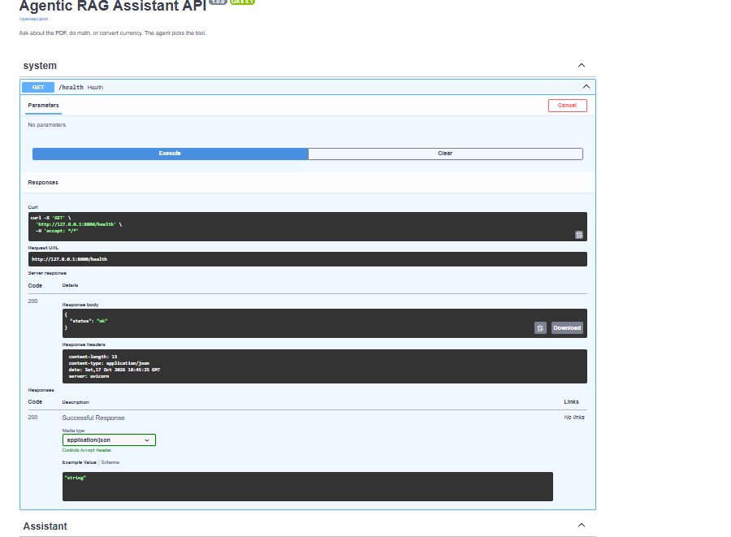
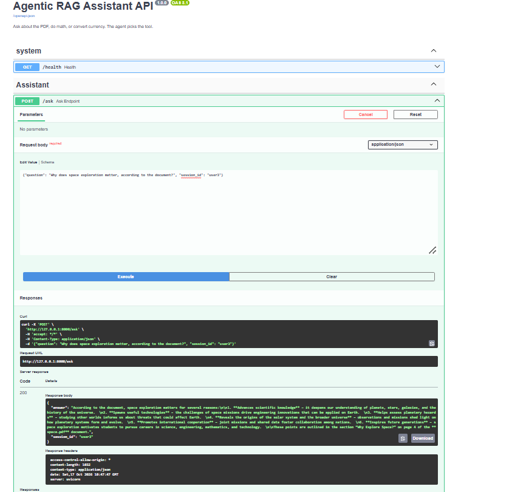
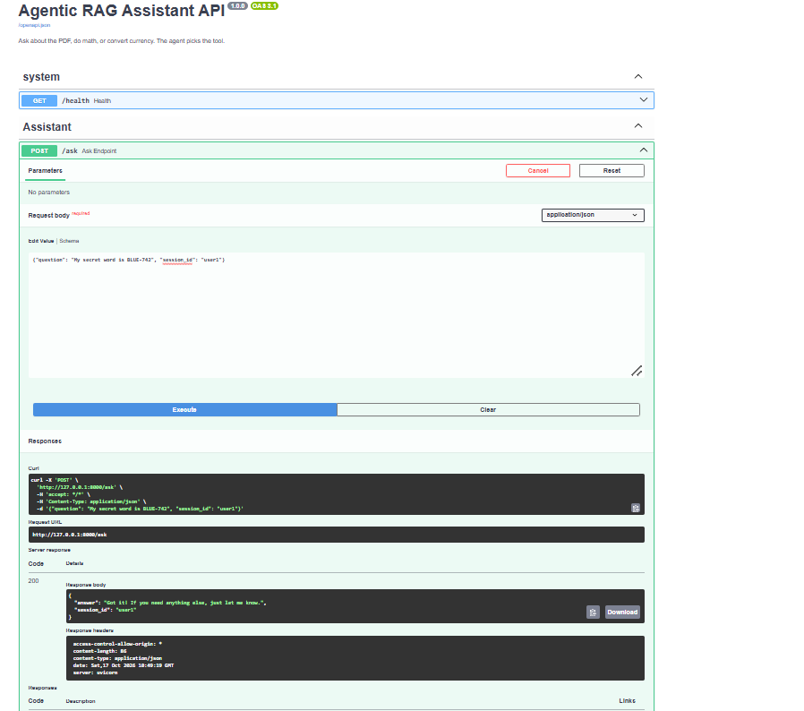
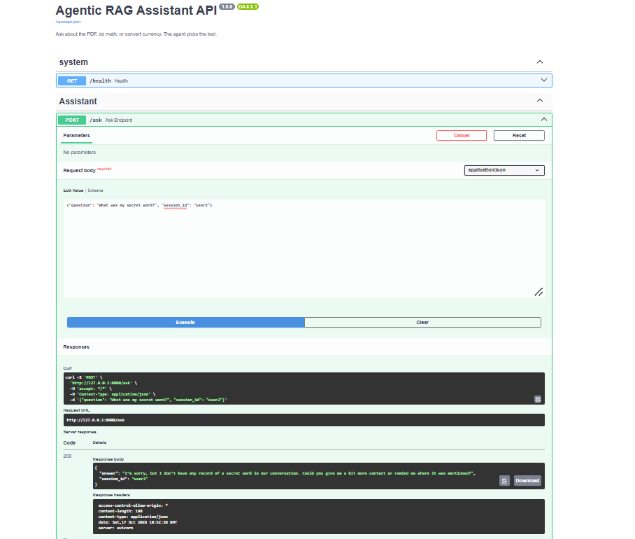

# Agentic RAG Assistant API

An AI agent behind a FastAPI endpoint. Send it a question and the agent decides which tool to use: search a PDF knowledge base (RAG), search the web, do math, or convert currency. It remembers earlier messages within a session.


## Live Demo

Try it here: **[Agentic RAG Assistant on Hugging Face Spaces](https://huggingface.co/spaces/jayeshmurthi49-byte/Agentic-RAG-Chatbot-API)**

The live Space is a chat interface for the same agent. The FastAPI endpoints (`/ask`, `/docs`) run locally, as described below. The Space may take a minute to wake up if it has been idle.

## Demo

**API docs (Swagger UI)**


**Grounded answer from the PDF**


**Memory within a session (`user1` remembers)**


**Memory is separate per session (`user2` does not know)**


## How it works

```
Client -> POST /ask -> FastAPI (Pydantic validation) -> ask()
       -> LangGraph loop: agent node <-> tools node -> answer
```

1. FastAPI validates the request (a question and a `session_id`).
2. `ask()` loads that session's earlier messages and sends them with the new question to the LangGraph agent.
3. The agent (an LLM) decides whether it needs a tool. If it does, the tools node runs it and the result goes back to the agent.
4. This repeats until the agent has no more tool calls, then it returns the final answer.
5. The question and answer are saved to the session's memory.

## Tools

| Tool | What it does |
|---|---|
| Document search (RAG) | Searches the PDF knowledge base and returns passages with source file and page |
| Web search | DuckDuckGo search for current information |
| Calculator | Safe arithmetic for expressions with numbers and `+ - * / % ( )` |
| Currency rates | Live exchange rate between two currencies |

The agent chooses a tool by reading each tool's name and description. No routing rules are hardcoded.

## Tech stack

Python, FastAPI, Uvicorn, Pydantic, LangGraph, LangChain, Groq (LLM), Chroma (vector store), HuggingFace sentence-transformers (embeddings), DuckDuckGo Search

## Project structure

```
.
├── main.py             # FastAPI app: /ask and /health
├── agent.py            # LangGraph agent, 4 tools, per-session memory
├── rag_tool.py         # PDF loading, chunking, embeddings, Chroma, document search tool
├── space.pdf           # Sample knowledge base
├── requirements.txt
├── screenshot/         # Images used in this README
└── .gitignore
```

## Run it locally

1. Clone the repo and open the folder.
2. Install dependencies:
   ```bash
   pip install -r requirements.txt
   ```
3. Create a file named `.env` in the project folder:
   ```
   GROQ_API_KEY=your_key_here
   ```
   Get a free key at console.groq.com (Groq, not xAI/Grok).
4. Start the server:
   ```bash
   uvicorn main:app --reload
   ```
5. Open `http://127.0.0.1:8000/docs` and try the `/ask` route.

On the first run, the embedding model (about 80 MB) is downloaded and a `chroma_db` folder is built from the PDF. Later runs load it from disk. To use a different PDF, replace `space.pdf`, delete the `chroma_db` folder, and restart.

## API

**`POST /ask`**

Request:
```json
{"question": "What is the main topic of the PDF?", "session_id": "user1"}
```
Response:
```json
{"answer": "...", "session_id": "user1"}
```
- The same `session_id` shares one conversation memory. `session_id` defaults to `"default"` if left out.
- `422` if the input is invalid (for example, a question under 3 characters).
- `500` with a generic message if the agent fails. The real error is printed in the server log.

**`GET /health`** returns `{"status": "ok"}`.

## Example questions

- `What is the main topic of the PDF?`
- `What does the document say about quantum computers? If it does not cover this, say so.`
- `What is 847 * 23, minus 100?`
- `Convert 20 INR to USD`
- Tell it `My secret word is BLUE-742`, then ask `What was my secret word?` in the same session.

## Design notes

- **Safe calculator.** Input is checked against an allowed set of characters before evaluation, and `**` is blocked, so arbitrary code can't be run through the tool.
- **Loop limit.** The agent loop stops after 12 steps, so a stuck agent can't run forever.
- **Tool errors return text.** A failing tool returns its error as text, so the agent can recover or explain, and the run doesn't crash.
- **Memory stores only questions and final answers.** Tool messages are left out, because they come in linked pairs and trimming one half would break the next call. Only the last 20 messages are kept.
- **`/ask` is a plain `def`.** The agent call blocks while it waits for the LLM, and FastAPI runs plain functions in a thread pool, so other requests aren't frozen.

## Known limitations

- Live information (weather, news) depends on web search results, which can be outdated. The assistant has no built-in clock.
- When no tool is used, answers come from the model's own knowledge and can contain mistakes.
- Conversation memory is stored in RAM and resets when the server restarts.
- The knowledge base is a single PDF.

## Future improvements

- Deploy to a cloud host (free tiers have little RAM, which is tight for the embedding model)
- Persist conversation memory in a database
- Return which tools were used in the API response
- Support uploading multiple PDFs
- Add authentication and rate limiting

## Author

Built by Jayesh Murthi, [GitHub](https://github.com/jayeshmurthi49-byte) | [LinkedIn](https://www.linkedin.com/in/jayesh-murthi-8b1653400)
